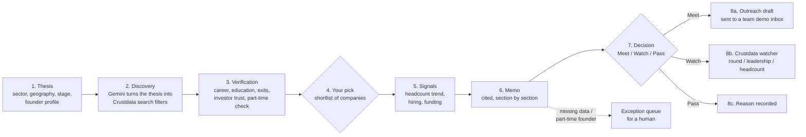
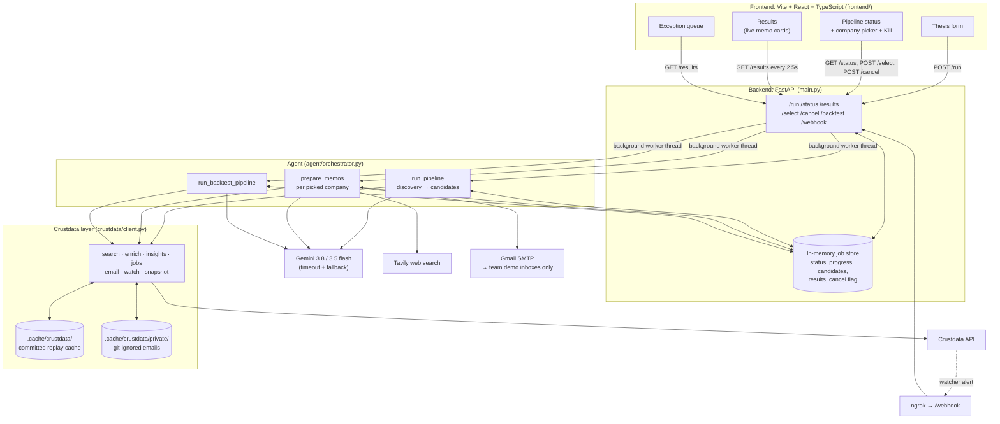
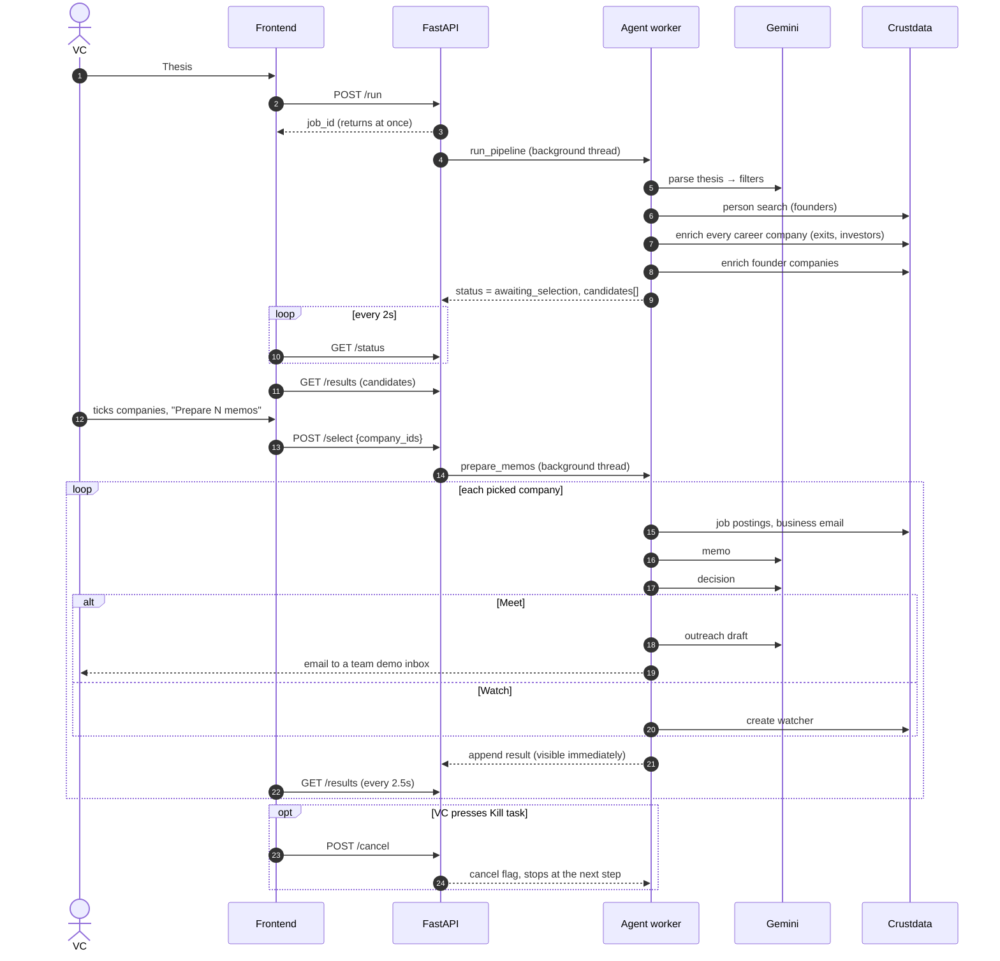
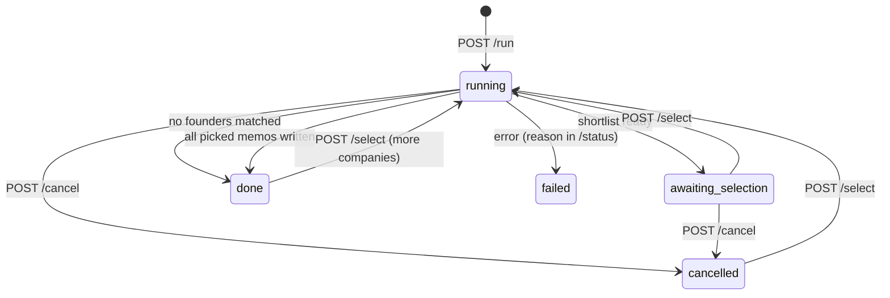

# CrushData: the first-pass VC analyst, replaced

> Give it an investment thesis. It finds the founders, verifies them, lets you pick who's worth a look, writes a cited diligence memo per company, makes a Meet / Watch / Pass call, drafts the outreach email, and sets a watcher on the ones that aren't ready yet.

Built in one night at **ContextCon 04** (Crustdata × YC, IIT Kanpur), theme **"Services, Replaced"**.

---

## Contents

1. [The service and who pays for it](#1-the-service-and-who-pays-for-it)
2. [What it does, step by step](#2-what-it-does-step-by-step)
3. [Where a person is in the loop (and where they aren't)](#3-where-a-person-is-in-the-loop-and-where-they-arent)
4. [How it's built](#4-how-its-built)
5. [Where Crustdata is called](#5-where-crustdata-is-called)
6. [Facts and verification](#6-facts-and-verification)
7. [Robustness and edge cases](#7-robustness-and-edge-cases)
8. [Backtest mode](#8-backtest-mode)
9. [How to run it](#9-how-to-run-it)
10. [API reference](#10-api-reference)
11. [Repository layout](#11-repository-layout)
12. [Approaches we tried: what worked, what didn't](#12-approaches-we-tried-what-worked-what-didnt)
13. [What's next, and why not now](#13-whats-next-and-why-not-now)
14. [Team](#14-team)

---

## 1. The service and who pays for it

**The job:** every seed fund, angel syndicate and VC scout runs the same loop every week. Take a thesis ("seed-stage developer tools in India, technical founders from IIT Kanpur"), find every founder who fits, check that they're real and full-time, pull the company's numbers, write a one-page memo per company, decide who to meet, email them, and remember to check back on the ones that are too early.

**Who does it today:** an analyst or associate, paid ₹1–3 lakh a month in India or $120k+ in the US, or an outsourced research firm billing per memo. A thorough first pass on one thesis is 2–3 days of LinkedIn, Crunchbase, Google and spreadsheet work, and it goes stale the moment it's done.

**What CrushData replaces:** that whole first pass, end to end, in minutes. The VC types the thesis, picks the companies they care about from a verified shortlist, and gets back finished, cited memos with a decision and an outreach draft for each one. The watchers keep checking the "not yet" companies after the analyst would have moved on.

| | Analyst today | CrushData |
|---|---|---|
| Sourcing for one thesis | 1–2 days | ~1 minute (24 companies found in 69s in our test run) |
| Memo per company | 1–3 hours | ~30 seconds (2 memos in 67s in our test run) |
| Sources cited per claim | rarely | always, with a confidence level |
| Follow-up on "too early" companies | a calendar reminder, often missed | a Crustdata watcher that fires on a new round, a new founder/CXO, or ~20% headcount growth |

---

## 2. What it does, step by step



1. **Thesis in.** The VC fills a form: sector, geography, stage, an optional free-text keyword, and an optional advanced founder profile covering university, field of study, previous company and role, years of experience, serial founder, previous exit, technical founder, publications, accelerator alumni, nationality, age range, and solo vs co-founded.
2. **Discovery.** Gemini parses the thesis into structured filters, and `search_founders` runs a Crustdata person search for founder-titled people matching them.
3. **Verification.** `founder_insights` builds a profile for every founder from their full career history:
   - **Career and education:** years of experience, technical or not, age range, nationality signals.
   - **Founder history:** serial founder or not, past exits during their own tenure, and whether a notable investor or accelerator (YC, Peak XV, Accel, Lightspeed, Antler, ...) ever backed a company they were at.
   - **Part-time check:** flags people who hold a founder title on the side while their main job is elsewhere.
   - **Grouping:** founders are grouped by company, and each company is enriched once.
4. **The VC picks.** The run pauses and shows the shortlist: name, location, founding year, headcount, funding, description and founders. The VC ticks the companies worth a memo.
5. **Signals.** For each picked company:
   - **Headcount:** now vs 6 months ago, from Crustdata's weekly headcount history.
   - **Hiring:** job postings in the last 90 days and which departments they're in.
   - **Funding:** rounds and investors.
6. **Memo.** Gemini writes summary, problem, market, product, competitive landscape and the founders' "x factor" from the Crustdata record. Tavily web search fills market context and GitHub or research details Crustdata doesn't hold. Every claim gets a citation.
7. **Decision.** Meet, Watch or Pass, with a confidence level and reasoning, judged against the thesis.
8. **Act within limits:**
   - **Meet:** a personalised outreach email is drafted. Under the event rules it is sent only to a team-owned demo inbox, never to the founder, with "Intended for: <real address>" at the top.
   - **Watch:** a Crustdata watcher is created to fire on a new funding round, a new founder or CXO, or headcount reaching current + max(5, 20%).
   - **Pass:** the reason is recorded.
9. **Memos appear one by one** in Results as each finishes. The run can be killed at any point.

---

## 3. Where a person is in the loop (and where they aren't)

We kept a human only where their judgment changes the result:

| Point | Why a person | What they see |
|---|---|---|
| **Picking companies** after discovery | The VC knows which names matter and which they've already seen; each memo costs ~3 LLM calls and credits | Checklist with company facts and founders, Select all / Clear |
| **Exception queue** | Data is missing (≥3 key fields unavailable), a founder looks part-time, or processing failed | `/exceptions` page with the reason, "Mark resolved" |
| **Kill task** | Wrong thesis, slow model, wants to stop spending | Button on the Pipeline and Results pages |

**No human is needed** for search, identity checks, enrichment, signals, memo writing, the decision, drafting outreach, routing it to the safe inbox, or creating watchers.

---

## 4. How it's built

### Architecture



**Models.**
- Gemini handles all language work: thesis → filters, memo, decision, outreach.
- `gemini-3.8-flash` is tried first. Every call has a 45-second timeout. A model that times out or returns 404 is skipped for the rest of the process, and a 503 moves straight to `gemini-3.5-flash`, then `gemini-3.5-flash-lite`.
- Up to three API keys rotate on rate limits (429).

**Tools.**
- **Crustdata:** search, enrich, jobs, email lookup, watchers.
- **Tavily:** web search for market context.
- **SMTP:** outreach, routed to demo inboxes.

**Where state lives.**

| State | Where | Lifetime |
|---|---|---|
| Jobs: status, progress, shortlist, results, cancel flag | Python dict in the FastAPI process (`jobs` in `main.py`) | Until the server restarts |
| Crustdata responses (search, enrich, jobs) | `.cache/crustdata/*.json`, committed to the repo | Permanent; replays the demo with zero API calls |
| Business-email lookups | `.cache/crustdata/private/`, git-ignored | Local only; never pushed to the public repo |
| Watchers | Crustdata (server side), alerts POSTed to `/webhook` via ngrok | Until cancelled |
| Frontend: current job id, resolved exceptions | `localStorage` (falls back to memory) | Per browser |

### One run, end to end



### Job lifecycle



---

## 5. Where Crustdata is called

Every call goes through `crustdata/client.py`. Base `https://api.crustdata.com`, `x-api-version: 2025-11-01`.

| Step | Function | Endpoint | Approx. cost |
|---|---|---|---|
| Find founders matching the thesis | `search_founders` | `POST /person/search` | ~0.8 credits / result |
| Resolve "previous company" names to ids | inside `search_founders` | `POST /company/identify` | free |
| Founder profile: exits, investor trust, age, technical, part-time | `founder_insights` | `POST /company/enrich` on every company in each career (batched 25 per call) | 2 / company, shared across founders, cached |
| Company profile: funding rounds, investors, founders, weekly headcount | `enrich_companies` | `POST /company/enrich` | 2 / company (usually already cached by the step above) |
| Headcount now vs 3/6/12 months ago | `headcount_signals` | none: computed from the weekly timeseries | free |
| Hiring | `get_hiring` | `POST /job/search` (last 90 days) | ~0.03 / posting |
| Founder's business email (display only) | `find_email` | `POST /person/enrich` with `contact.business_emails` | ~2 / person, cached privately |
| Watch "too early" companies | `watch_company` | `POST /watch/company` | free to create, 5 / alert |
| Read a watcher alert | `parse_watch_event` | none: parses the `/webhook` body | free |
| Backtest: the company as of a past date | `snapshot_as_of` | none: trims enrich data to the date | free |

A full thesis run costs roughly 75 credits for 25 companies plus 10–15 per founder the first time. Re-runs come from the cache and cost nothing.

---

## 6. Facts and verification

**Every claim has a source.** Each memo carries a citation list: the claim, where it came from (Crustdata record with a LinkedIn URL a person can open, or the web), and a confidence level:

| Level | Meaning |
|---|---|
| `verified` | Read directly from a Crustdata record |
| `web` | From a web search result |
| `inferred` | Derived (e.g. age range from graduation year, growth rate from the headcount series) |
| `unavailable` | We looked and couldn't find it, so the memo says so |

**We say "can't verify" instead of guessing.**
- The Crustdata layer never raises. On any failure it returns `None` and `client.last_error` says why (`402 insufficient_credits`, `network error`, `cache miss`, ...), so the memo can write "could not verify X because Y".
- The memo prompt forbids inventing facts. `None` means unknown, never absent: "no GitHub found" is not the same as "has no GitHub".
- Crustdata reports unknown funding as `0`. We show that as "unknown", never "$0".

**Entities are deduplicated on ids, never names.** Founders are keyed on `crustdata_person_id` and companies on `crustdata_company_id`. Two people called "Rahul Sharma" stay two people, and two founders of one company become one memo.

**Exits and investors are checked against the person's tenure.**
- Big employers carry noisy deal history: Adobe shows as "acquired" four times. So an exit counts only if it happened while the founder was there.
- "Backed by a notable investor" is checked across every company in the founder's career against a curated list (YC, Peak XV/Sequoia, Accel, Lightspeed, Antler, Techstars, a16z, Blume, Elevation, ...), plus any investor Crustdata tags as an accelerator.

**Data quality problems become exceptions, not quiet guesses.** A company is flagged for review when:
- 3 or more key fields are unavailable, or
- a founder looks part-time (founder title on the side, primary job elsewhere), or
- processing failed. That company gets an exception card while the rest of the batch carries on.

---

## 7. Robustness and edge cases

| Problem | What happens |
|---|---|
| Crustdata rate limits (enrich 15/min, search 30/min) | The client paces calls and retries 429 using `x-ratelimit-reset` |
| Crustdata 5xx / network error | Retried with backoff (idempotent reads only); then `None` + `last_error` |
| 400–403 (bad filter, endpoint not on our plan) | Never retried; the reason is recorded |
| Out of credits (402) | Stops at once with a clear error instead of burning retries |
| Whole API down / no Wi-Fi at demo time | `USE_CACHE=true` replays every Crustdata call from the committed cache with zero API calls |
| Gemini slow or overloaded (seen live during the event: 3.8-flash timing out, 503s) | 45s timeout per call; timed-out or missing models are skipped from then on; 503 moves straight to the next model; key rotation on 429 |
| Gemini returns the wrong shape (e.g. "market" as a list) | The memo model reshapes lists into bullets instead of rejecting the memo |
| One company fails mid-batch | Caught per company: it becomes an exception card, the batch continues |
| A run is going nowhere | Kill task: `POST /cancel` stops at the next step; a call already in flight finishes first |
| Two "Prepare" clicks, or a new pick while a stopped run is still finishing | Rejected with 409 until the previous worker has exited, so nothing runs twice |
| Long blocking calls freezing the server | Pipelines are plain `def`, which FastAPI runs in a worker thread. `/run` answers in ~0.3s and `/status` in ~0.2s mid-job; as `async def` they froze the whole server |
| Messy input | Thesis fields are free text or multi-select; Gemini normalises them into filters. Unknown fields from the frontend are ignored |
| Founder with no LinkedIn URL | Email lookup is skipped (it used to fire 25 failing calls and burn the rate limit) |
| Never contacting real people | `outreach_recipient` only ever returns a team inbox from `DEMO_RECIPIENTS`. The real address is shown in the UI and memo for the VC, but never emailed |
| Never sending twice | Each picked company is processed once per job (`done` set). Re-picking skips companies that already have a memo |

**Not handled yet:** resuming after a server crash. Jobs live in memory, so a crash loses in-flight jobs, though not the Crustdata cache. See [What's next](#13-whats-next-and-why-not-now).

---

## 8. Backtest mode

`POST /backtest` with a thesis and an `as_of_date` asks: *if we'd run this thesis on that date, would our Meets have raised afterwards?*

- **Rebuilding the past:** `snapshot_as_of(profile, date)` rebuilds each company as it was on that date: headcount from the weekly series, funding rounds before the date, and founders' roles and exits trimmed to the date.
- **The outcome:** rounds after the date (`outcome_rounds`).
- **No peeking at the future:** web search is switched off in backtests, because it would leak what happened later, and `leakage_warnings` lists fields that are only available as of today (description, industries, current leadership).
- **Scoring:** precision and recall of Meet calls, over companies whose outcome is known.

---

## 9. How to run it

### Requirements
- Python 3.11+
- Node 18+
- A Crustdata API key and a Gemini API key

### Backend

```bash
pip install -r requirements.txt
cp .env.example .env          # then fill in CRUSTDATA_API_KEY and GEMINI_API_KEY at least
uvicorn main:app --port 8000
```

| `.env` key | Needed? | What for |
|---|---|---|
| `CRUSTDATA_API_KEY` | yes | All Crustdata calls |
| `GEMINI_API_KEY` (`_2`, `_3` optional) | yes | Thesis parsing, memos, decisions, outreach |
| `TAVILY_API_KEY` | optional | Web context in memos |
| `SMTP_EMAIL`, `SMTP_PASSWORD` | optional | Actually send outreach (to demo inboxes only) |
| `DEMO_RECIPIENTS` | for outreach | Comma-separated team inboxes that receive every outreach email |
| `WATCH_WEBHOOK_URL` | for watchers | `https://<your-ngrok>/webhook` |
| `USE_CACHE` | optional | `true` = offline replay from `.cache/` |

### Frontend

```bash
cd frontend
npm install
echo "VITE_USE_MOCK=false" > .env.local   # without this the UI uses mock data
npm run dev                                 # http://localhost:5173
```

`VITE_API_BASE` defaults to `http://localhost:8000`. To serve the backend to a deployed frontend, run `ngrok http 8000` and set `VITE_API_BASE` to the ngrok URL. `frontend/vercel.json` makes page refreshes work on Vercel.

### Offline demo (no API calls)

```bash
USE_CACHE=true uvicorn main:app --port 8000
```

Every Crustdata call is served from `.cache/crustdata/`. A thesis that wasn't recorded returns a clear "cache miss" instead of an empty result.

### Tests

```bash
python -m crustdata.test_client          # offline: transport, retries, cache, email routing, founder insights
python -m crustdata.test_client --full   # adds a live smoke test of every Crustdata function
```

---

## 10. API reference

| Method | Path | Body | Returns |
|---|---|---|---|
| `POST` | `/run` | `{"thesis": {sector, geography, stage?, founder_keyword?, founder_profile?}}` | `{job_id}`. Discovery starts in the background |
| `GET` | `/status/{job_id}` | | `{status, progress: {stage, companies_found, companies_processed}, error}` |
| `GET` | `/results/{job_id}` | | `{status, progress, candidates[], results[]}`. Results grow while memos are written |
| `POST` | `/select/{job_id}` | `{"company_ids": ["9920", ...]}` | Starts memos for the picked candidates. 409 while a worker is still running |
| `POST` | `/cancel/{job_id}` | | Stops the job at the next step |
| `POST` | `/backtest` | `{"thesis": {...}, "as_of_date": "2024-01-01"}` | `{job_id}`. Results include `actual_outcome`, `correct_call`, and a `backtest_summary` with precision/recall |
| `POST` | `/webhook` | Crustdata watcher payload | Logs which watched company changed and what |

`status` is one of `running`, `awaiting_selection`, `done`, `failed`, `cancelled`. `stage` is one of `discovery`, `verification`, `selection`, `memo_generation`, `done`.

Each result: company facts, `decision` (`meet`/`watch`/`pass`), `confidence`, `founders[]` (title, education, past companies, part-time flag, business email + status), `memo_sections`, `signals`, `citations[]`, `exception_flag` + `exception_reason`, `outreach_email`.

---

## 11. Repository layout

```
.
├── main.py                  FastAPI app: endpoints, in-memory job store, webhook
├── agent/
│   ├── orchestrator.py      run_pipeline (discovery), prepare_memos (per company), backtest, Gemini calls
│   ├── prompts.py           thesis-parse, memo, decision and outreach prompts
│   └── models.py            Pydantic models shared with the frontend contract
├── crustdata/
│   ├── client.py            the whole Crustdata layer: search, enrich, insights, jobs, email, watch, cache
│   ├── test_client.py       offline checks + --full live smoke test
│   ├── README.md            function-by-function interface doc
│   └── API_NOTES.md         what we learned about the API (fields, limits, backtest feasibility)
├── frontend/                Vite + React + TS: Thesis, Pipeline (picker + kill), Results (live), Exceptions
├── .cache/crustdata/        committed replay cache (emails excluded)
├── NOTES.md                 build log: approaches, what worked, what didn't
└── requirements.txt
```

---

## 12. Approaches we tried: what worked, what didn't

**Search founders first, not companies.**
- **What we did:** we started from people (a person search filtered by school, past employer, field of study and keywords) and grouped them into companies, instead of searching companies by sector and then looking for founders.
- **Why it worked:** the founder profile is most of the thesis, and person search already returns full career history at ~0.8 credits, which made the planned per-person enrich step unnecessary.

**Pause for the VC before writing memos.**
- **First version:** the run wrote all 25 memos in one go and showed nothing until the end, and a slow model made it look frozen.
- **Now:** the run stops after discovery, the VC picks, and memos appear one by one as they finish. It's cheaper, faster to first result, and a human only steps in where their choice matters.

**Things that didn't work at first, and the fix:**
| What went wrong | Fix |
|---|---|
| Fuzzy title search returned a "Founding Captain" | Strict founder-title post-filter |
| Corporates like TATA Power flagged as investors | Investor = has a VC/investment industry tag |
| Adobe "acquired" 4 times showed up as founder exits | Only exits during the person's tenure count |
| Many "founders" have a different full-time job | Exposed `founder_roles` → part-time founder flag in the memo |
| Every company came back empty and flagged (orchestrator read keys the data layer didn't return) | Flat `build_company_data` / `build_signals` from real fields; flagged dropped 25 → 5 |
| Email lookup called with no LinkedIn URL: 25 × 400 and a burnt rate limit | Guard in the client; outreach only with a LinkedIn URL |
| Watch threshold was a flat "5 people" | Current headcount + max(5, 20%) |
| Backtest used web search, which leaks the future | Snapshot-only backtest; precision/recall over known outcomes |
| `async def` pipeline froze the server for the whole run | Plain `def`, run in a worker thread |
| `gemini-3.8-flash` timing out during the event, with no timeout set | 45s timeout, skip dead models, 503 → next model at once |
| "$0" funding on companies Crustdata knows nothing about | `0` is shown as unknown |

**What we dropped.**
- **Crustdata's contact-enrich endpoint:** it's disabled on our plan. `person/enrich` with `contact.business_emails` gives the same address.
- **"Active job postings":** Crustdata has no open/closed flag, so we report "postings in the last 90 days" rather than claim roles are open.

**The hardest case.** Telling a real full-time founder from someone with "Founder" on a side project. Search returns both. We compare each person's primary title with their founder roles and flag the mismatch. The VC gets a "possible part-time founder" exception instead of a memo that quietly overrates the company.

---

## 13. What's next, and why not now

| Next | Why not tonight |
|---|---|
| **Persist jobs** (SQLite/Postgres) so a restart resumes in-flight runs | The in-memory store was enough for a single-machine demo, and resuming safely means making each step idempotent (no double emails, no double watchers) |
| **Host the backend** (Render/Railway/Fly) instead of a laptop + ngrok | Runs take minutes in a background worker; serverless platforms (Vercel) stop work after the response, so it needs a long-running host |
| **Re-run a company automatically when its watcher fires** | The webhook already parses the change; linking it back to the job and thesis needs the persistent store above |
| **Real outreach with approval** (VC approves each draft, then it goes to the founder) | Event rules forbid contacting real people, so every send goes to a team inbox |
| **Richer open-source signal** (repos, languages, commit activity) | Crustdata's GitHub data is filter-only on our plan; today the memo web-searches for it |
| **Ranking the shortlist** before the VC picks (thesis-fit score) | The VC's own pick was the better use of the time we had |
| **Backtest at scale** to tune the decision prompt | Needs many theses × dates; our sample was small and the credits/time went into the live flow |

---

## 14. Team

| Who | Built |
|---|---|
| **Bhav Agarwal** | Crustdata data layer (`crustdata/`): search, founder insights, exits and investor trust, email routing, watchers, cache, backtest snapshots; integration bug fixes |
| **Aman Ahuja** | Agent and backend (`agent/`, `main.py`): orchestration, prompts, Gemini, memo/decision/outreach, backtest |
| **Abhiram** | Frontend (`frontend/`): thesis form, pipeline, results, exception queue |

Built at ContextCon 04 (Crustdata × YC, IIT Kanpur), November 5–6, 2026.
